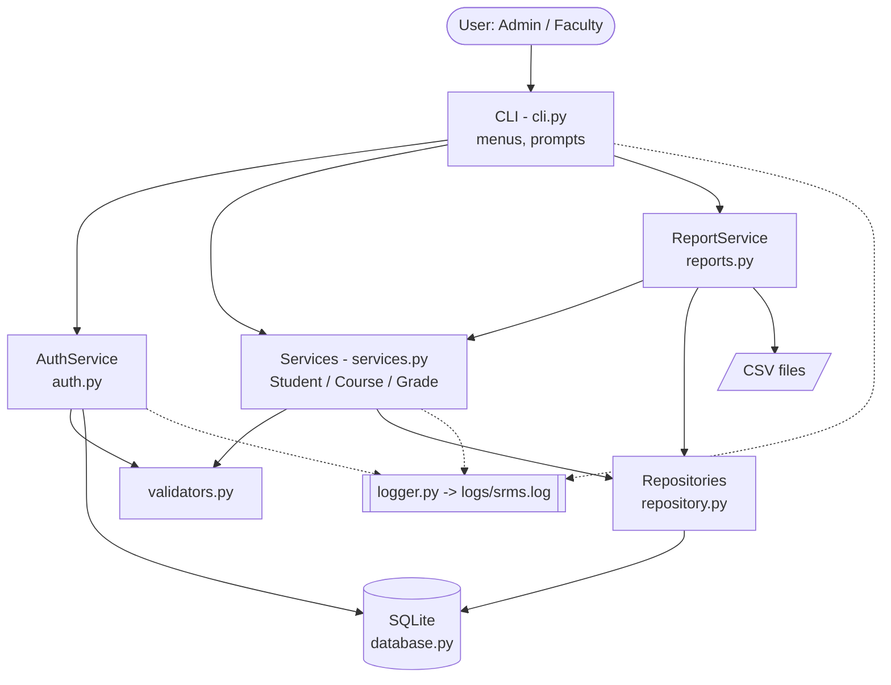
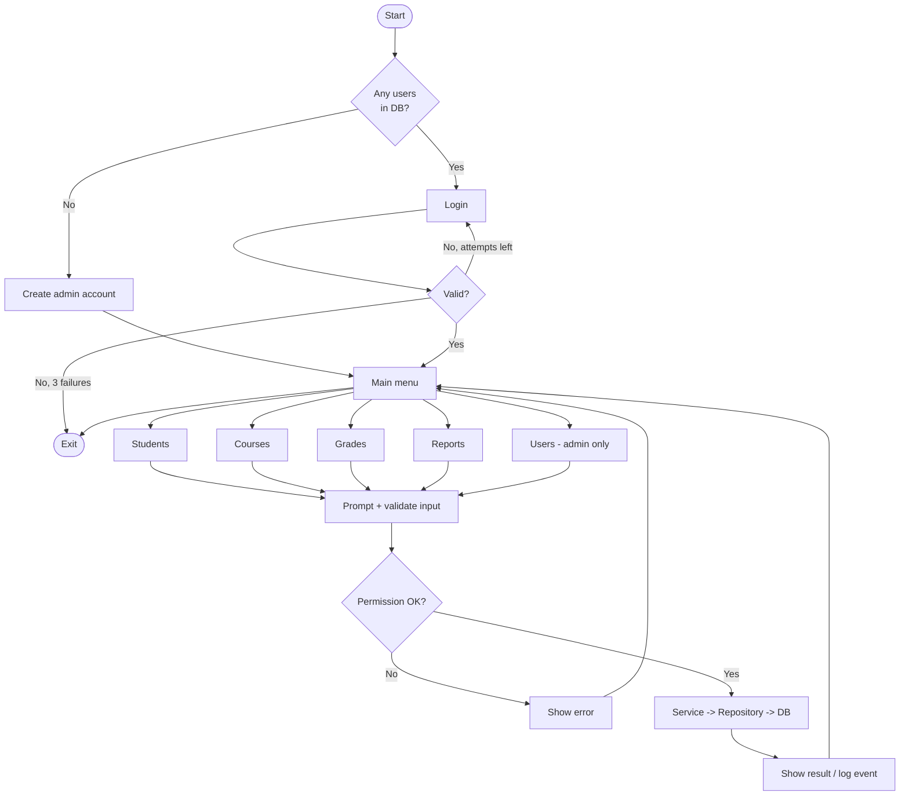
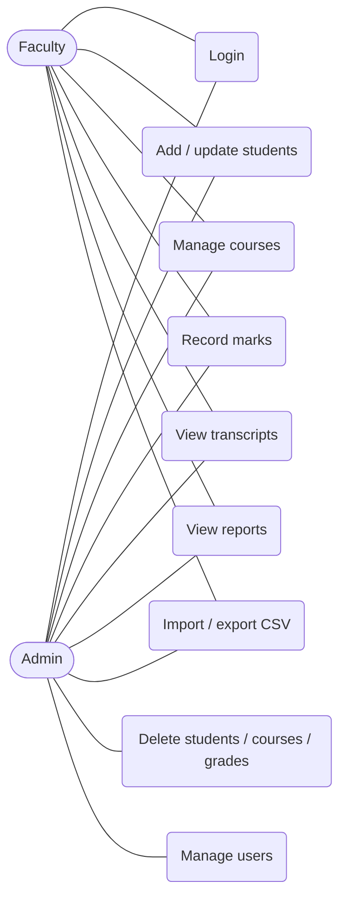
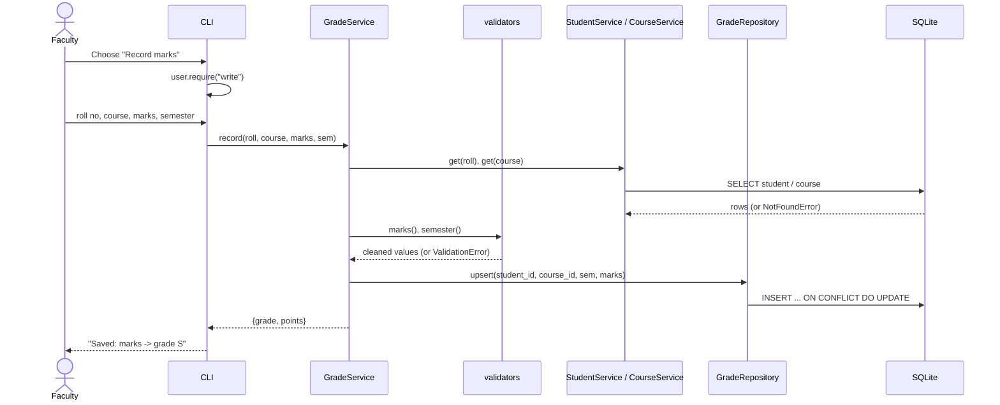
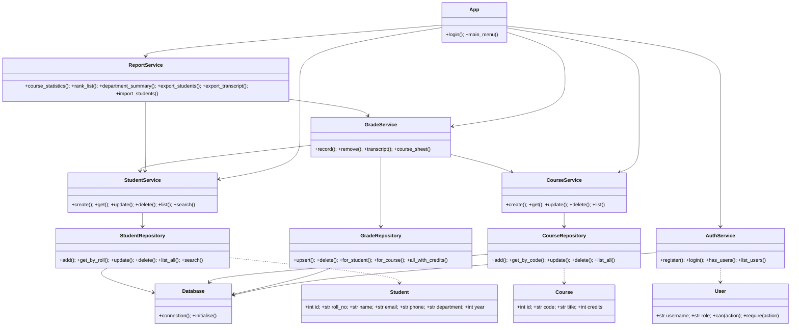
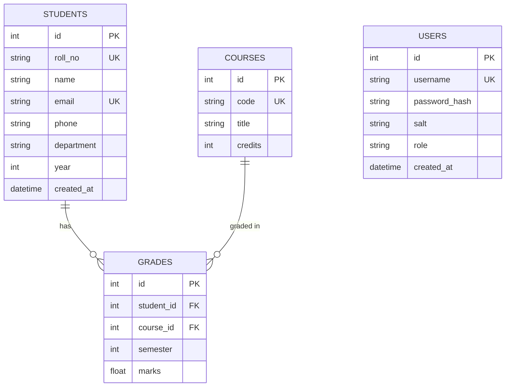

# Design Document

Diagrams are written in [Mermaid](https://mermaid.js.org) – GitHub renders them automatically.
For the PDF report, paste each block into https://mermaid.live and export as PNG.

## 1. Non-functional requirements
| # | Category | Requirement | How it is met |
|---|----------|-------------|---------------|
| 1 | Security | Passwords never stored in plain text; only authorised roles may delete or manage users | Salted PBKDF2-SHA256 (200k iterations), `hmac.compare_digest`, role checks (`User.require`) |
| 2 | Reliability / Error handling | Bad input or DB errors must not crash the app or corrupt data | Validators, custom exceptions, transactions with rollback, foreign keys & CHECK constraints |
| 3 | Usability | Clear menus, re-prompt on invalid input, confirmation before deletes | `ask()` retry loop, `confirm()`, friendly messages |
| 4 | Maintainability | Layered, modular code that is easy to extend and test | Presentation → Service → Repository → DB separation; 37 unit tests |
| 5 | Logging | Trace logins, changes and errors | Rotating log file `logs/srms.log` |
| 6 | Performance | Common operations < 1 s for ~10,000 students | Indexes on department and grade foreign keys, parameterised queries |
| 7 | Portability / Resource efficiency | Runs anywhere with Python, no installs | Standard library only, SQLite single file |

## 2. System architecture

## 3. Workflow diagram

## 4. Use case diagram

## 5. Sequence diagram – recording a grade

## 6. Class diagram

## 7. ER diagram

`GRADES` has a composite unique constraint `(student_id, course_id)` and `ON DELETE CASCADE` on both foreign keys.

## 8. Design decisions & rationale
- **Layered architecture** – UI, business rules and SQL are separate, so each can be tested or replaced alone (e.g. swap the CLI for a web UI without touching services).
- **SQLite** – zero-setup, transactional, file-based; enough for a departmental tool.
- **Repository pattern** – all SQL in one file, parameterised to prevent SQL injection.
- **Dataclasses for models** – concise, typed, easy to convert to dicts/CSV.
- **Custom exceptions** – the CLI catches `SRMSError` and shows friendly text; unexpected errors are logged with a stack trace.
- **Upsert for grades** – re-entering marks corrects the record instead of failing.
- **Credit-weighted CGPA** – matches how university CGPA is really computed.
- **Standard library only** – nothing to install, fewer things to break.
